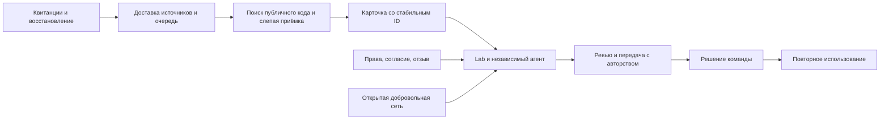

# Приёмка Core Mission · 27 ноября 2026

База продукта `30523b5abc7df149909553b1d740edccf8372b1b`. Изменения продукта влиты как `8b3fcc2706e99844e5c18ef10a9fbdde96b39e8c` через [PR #120](https://github.com/akimfomin/PortBridge/pull/120). Статусы берутся из [реестра](../../../docs/PORTBRIDGE-CHECKLIST.md). Для отдельных проверок использованы [Master Spec V3](../../../docs/PORTBRIDGE-SPEC.md), [Discovery Spec](../../../docs/PORTBRIDGE-DISCOVERY-SPEC.md) и [PS5 Spec](../../../docs/PORTBRIDGE-PS5-SPEC.md).

## Очередь и границы результата

Открытые технические наблюдения теперь сохраняются в SQLite как ожидающие работы независимо от витрины. Планировщик делит кэш между ручным входом по ссылке и облачным опросом. За проход остаётся до пяти внешних запросов, но каждый может сохранять 15 результатов. Витрина показывает до пяти для каждой из 64 недавних записей. Локальный запрос по точной ссылке читает и старые записи, а Radar проверяет изменение результатов независимо от исходной очереди. Корневые причины generic GPU failure не выводятся из совпадения кода ошибки. Механизм без прямой ссылки остаётся кандидатом для технического ревью.

- В модульной проверке 130 задач, первый проход сохраняет 120 и один запрос, после публичного checkpoint второй обрабатывает оставшиеся 10 без нового запроса. Отдельно воспроизведены ограничение GitHub, продвижение другой темы, постановка изменившейся ревизии, восстановление общего кэша и истечение срока внешнего кандидата без закреплённой ревизии.
- Независимый ревьюер завершил процесс во втором поиске с кодом 79 на временной базе. При немедленном перезапуске сработала аренда. После принудительного истечения только аренды в контрольной базе повтор выполнил ровно оставшийся запрос. Первый результат сохранился.
- Раздельные пространства кэша сначала позволяли ручному входу заменить сохранённые 15 результатов более короткой выдачей. Исправлено общей записью кэша и раздельной проекцией. Приёмка сохраняет отдельный тест. Ещё один контроль показал, что старый неприкреплённый внешний кандидат оставался свежим при свежем получателе. Теперь такой кандидат наследует срок поиска.
- На публичном снимке из 31 898 наблюдений новая очередь принимает 3 447 задач по 729 темам. Среди обновлённых за последние 24 часа 1 303 задачи, 437 тем. Тест с грубой симптоматикой оставляет аналогичные поиски доступными вручную. Даже при идеальном расписании текущий бюджет допускает до 240 запросов в сутки. Суточное покрытие всей очереди не подтверждено. Внешние кандидаты и слой поиска по файлам остаются отдельными ограничениями.

[Архитектура, команды и откат](../../../docs/decisions/014-bounded-historical-discovery.md) · [Локальная приёмка](https://github.com/akimfomin/PortBridge/pull/120) · [Первый облачный тест старого ожидания 5 вместо 15](https://github.com/akimfomin/PortBridge/actions/runs/45941256987) · [Повтор исправленной ветки](https://github.com/akimfomin/PortBridge/actions/runs/45941602814)

На итоговом кандидате `afa6c7ab71d9e5c46bde8f4b1855983dd451e978` локально прошли 302 модульных теста, проверка JavaScript, экспорт и проверка публикации. Облачный предварительный запуск подтвердил тесты и экспорт на этой ветке. Самостоятельная доставка по расписанию учитывается отдельно.

Живой [запуск main](https://github.com/akimfomin/PortBridge/actions/runs/45941742926) прошёл сборку, выкладку Pages, проверку Pages и подготовку публичного checkpoint. На первом проходе 3 462 задачи, 5 внешних поисков, 2 ответа кэша, 3 455 готовы продолжаться. В 07:50:44 МСК опубликовано согласованное поколение сайта, API и Lab. Публичный Preflight по XCL #2322 по-прежнему вернул проверенный LLVM stack coloring. Все 16 структурированных задач Lab имели свежую проверку отчётов. Общий health partial. [Данные сайта](https://akimfomin.github.io/PortBridge/data/site.json) · [Партнёрская лента](https://akimfomin.github.io/PortBridge/data/partner.json)

Последние проверенные два плановых запуска до патча разделены 8 ч 47 мин. После начала окна эксплуатационной приёмки независимо подтверждена одна плановая квитанция от 03:42:43 МСК в [запуске #45917400112](https://github.com/akimfomin/PortBridge/actions/runs/45917400112). Проверка анонимным GitHub REST позже упёрлась в ограничение запросов. Ручные облачные проверки и публикации по push в недельный подсчёт не входят.

### Покрытие ведущих веток

В прежнем публичном корпусе отсутствовали все пять выбранных PR Vice-Tay. VI-BR-PORT также отсутствовал среди регулярных источников, хотя точно связан с контролем #1241 → #141. [PR #122](https://github.com/akimfomin/PortBridge/pull/122) добавил две публичные записи GPL-3.0. У Vice-Tay сохранён точный аппаратный отчёт исходной версии #121, у VI-BR-PORT отмечен исходный адаптированный патч. Облачное превью и 302 теста прошли. Этот выпуск увеличивает покрытие источников. На главных числах независимой приёмки остался исходный снимок. [Сборка изменения источников](https://github.com/akimfomin/PortBridge/actions/runs/45942821723)

## Качество

Исходную M5.3 повторили офлайн по сохранённым ответам. Проигрывание пяти случаев дало пять ссылок у базы и одиннадцать у опытной версии при **0/5 полезных решений в каждой**. Оригинальные запуски потратили 3 и 5 поисков соответственно. Промахи включали перепутанный профиль кэша, поиск теста заголовков только в issues, общий device loss вместо владения изображением, уже известный неполный пример errno и HRESULT вместо поведения сравнения NaN. [Разбор всех пяти задач](../m53/assessment.md) · [Ручные источники](../m53/manual.md)

Для сравнения нового локального ранжирования отдельный участник до результатов заморозил 30 PR из шести проектов. Совпали все 30 выбранных SHA, заголовков и хешей тел. В слепой ручной разметке содержатся 2 применимые внешние связи, 2 подсказки авторов, 1 история в том же проекте, 2 отрицательных контроля и 23 неизвестных. Ни один подтверждённый внешний источник и ни одна из двух подсказок не появились в первой пятёрке обеих версий. На обеих отрицательных задачах пусто. Обе версии выдали ссылки для 6/30. Всего 15 и 17 ссылок соответственно. Точность высокой уверенности и общий recall из этих данных не вычисляются. Это проверка слоя локального каталога на общем снимке, отдельно от сетевого входа M5.3.

По обычному GitHub Search на двух вручную разобранных внешних случаях использовали указанные ниже точные токены. На KytyPS5 второй результат указывает на схожую ошибку того же формата и полезен как исторический контрпример. Необходимые тесты `INPUT_ATTACHMENT` и пустой маски были найдены вручную в файле Khronos. Для XCL первый результат нашёл задачу Xenora с теми же именами API, но без ветки переключения OEM/ANSI. Она проверена вручную в Wine. Такой поиск даёт один применимый исторический указатель и ноль готовых проверок из двух. [Фактические пять URL и запросы](github-search.json)

| Контроль до и после | Доказательство и граница |
| --- | --- |
| VIctory-fork #1241 → VI-BR-PORT → Vice-Tay #141 | [Исходный #1241](https://github.com/fxceless/victory-fork/pull/1241), [перенос](https://github.com/edsuuu/VI-BR-PORT/commit/5c17c8c83b782a9c5f1bfa12fb1d2fa438c23e5b), [приёмник](https://github.com/TaynanGT/Vice-Tay/pull/141). Три разных stable patch ID. У исходного изменения и переноса совпали 96 нормализованных знаковых изменённых строк в трёх файлах. С Vice-Tay совпали 91. [Отрицательный контроль Vice-Tay #144](https://github.com/TaynanGT/Vice-Tay/commit/0c9600fc55b8fed051b9182db3a2c800b5cd58fe) дал 1 совпавшую строку из 83. Фактическое происхождение подтверждается атрибуцией, совпадение строк остаётся кандидатом на анализ. Вычисление повторено новым `audit/core_patch_overlap.py` на отдельных публичных .patch без применения патчей. До появления публичных ссылок возможность системой не подтверждена. |
| Vice-Tay #138 ↔ AnyXboxX | [itbegoose](https://github.com/TaynanGT/Vice-Tay/issues/138#issuecomment-7209594401) сообщил похожий симптом без точного парного AnyXboxX-прогона. Исходного #138 нет в оцениваемом снимке. [Повтор и следующий шаг TaynanGT](https://github.com/TaynanGT/Vice-Tay/issues/138#issuecomment-7209753118) задают сравнение по действующему режиму relay и первой строке reset. |
| Continued #1867 ↔ VIctory #464 | На том же входе второй ранг стал первым после снижения веса одинакового кода ошибки. Есть отдельная проверка пересчёта после remap. Запись через второй alias требует отдельного контроля. [Continued](https://github.com/ubiquitarianism/leonida/pull/1867) · [VIctory](https://github.com/Marvisak/VIctory/blob/9dd1507872c618cfb6e21a1168debcaf76823967/crates/victory-gpu/src/watch.rs#L425) |
| XCL #2940 ↔ кэш PSO | Структурный поиск на общем снимке пуст. [XCL #2940](https://github.com/xcl-dev/xcl/pull/2940) проверяет принятие старого D3D12 blob и сокращение после создания. [Continued #2392](https://github.com/ubiquitarianism/leonida/pull/2392) подтверждает межпроцессное попадание для Vulkan cache, что задаёт идею контроля, но другую величину. |
| VIctory #1419 и Dathinel | [Самостоятельный прогон](https://github.com/Dathinel/victory-4gb/issues/10#issuecomment-7208842295) и [возврат](https://github.com/fxceless/victory-fork/pull/1419#issuecomment-7208842607) подтверждают координацию PortBridge на точном `8d1162e`. Автоматическое обнаружение до ручного подбора не подтверждено. |
| AnyXboxX #476 ↔ VIctory-fork #607 | На том же входе пусто → ранг 1. [VIctory](https://github.com/fxceless/victory-fork/blob/77056c3d53296fcadd4ee55df08073a5616a1937/crates/victory-shader/src/emit/intersect.rs#L291-L300) показывает проверку нагрузки второй половины 128-байтного узла 64 КиБ. Дата обнаружения до ручного поиска неизвестна. [AnyXboxX](https://github.com/LooperSalty/AnyXboxX/pull/476) |
| AnyXboxX #129, #133, #203 | [VIctory #571](https://github.com/Marvisak/VIctory/pull/571#issuecomment-7128201680) и [#129](https://github.com/LooperSalty/AnyXboxX/pull/129) связаны точной константой `0xBEAB1357`. [#133](https://github.com/LooperSalty/AnyXboxX/pull/133#issuecomment-7136721736) использует физический контроль Lyrnc. [#203](https://github.com/LooperSalty/AnyXboxX/pull/203) подтверждает отдельное исправление с отсылкой к контрпримеру #133 в том же проекте. История задокументирована, доказательства автоматического первенства нет. |

### Воспроизведение

[Полный top-5 базы](local-baseline.json) · [Полный top-5 кандидата](local-candidate.json) · [Правило отбора и SHA](core-discovery-frozen-30.json) · [Независимая разметка](core-discovery-independent-labels.json)

Снимок корпуса — публичный `data/observations.json`, его контрольная сумма в этой проверке `1f1ca188e99a3eaa167b73be629b7f3a9eca17e1af7a98c0c9004f83956c5057`. Он обновляется на Pages. Первоначальное поколение собрано в [запуске #45936191980](https://github.com/akimfomin/PortBridge/actions/runs/45936191980) и входит в его временный артефакт `github-pages`. Не сравнивать версии на разных снимках. `inputs.json` хранит локально JSON, ключ — URL, поля — `title, body, head_sha, state, merged` из публичного PR. Сырые тела в ветку аудита не включены; хеш и SHA фиксируются перед запуском. Вывод перечисляет недоступные закреплённые входы, если тело или SHA изменились.

```sh
python -B audit/core_discovery_replay.py --code BASE_CHECKOUT --selection audit/evidence/core-mission/core-discovery-frozen-30.json --labels audit/evidence/core-mission/core-discovery-independent-labels.json --corpus observations.json --inputs inputs.json
python -B audit/core_discovery_replay.py --code CANDIDATE_CHECKOUT --selection audit/evidence/core-mission/core-discovery-frozen-30.json --labels audit/evidence/core-mission/core-discovery-independent-labels.json --corpus observations.json --inputs inputs.json
python -B -m unittest discover -s tests -v
python -B -m portbridge --db sample.sqlite3 export --out dist
python -B -m portbridge.release_gate dist
python -B audit/m6_autonomy.py --since 2026-11-26T21:07:13Z
python -B audit/core_u8_replay.py Vop3LegacySourceModifiers.cpp
python -B audit/core_patch_overlap.py origin.patch vi-br.patch vice.patch unrelated.patch
```

Для CPU-проверки сохраните локально [закреплённый файл AnyPS5](https://github.com/boykopovar/AnyPS5/blob/4c57426b51b5f8a9419bb2aa518ca2244f74866f/core/libs/prx/libSceAgcDriver/tests/execution/Vop3LegacySourceModifiers.cpp#L38-L105). Скрипт считывает массивы чисел из него и не компилирует исходник. Три результата соответственно 32/32, 30/32 и 31/32. При откате вернуть код обычным revert и использовать предрелизный checkpoint, потому что старая проверка схемы не знает таблицу очереди.

## Свежая помощь и независимые участники

- **Xbox2Windows #2997 → AnyPS5 #501.** Radar сохранил связь в 03:51:18 UTC, через 5 мин 35 с после создания #2997 в 03:45:43 и до ручной проверки. В исходном #2997 не было ссылки на AnyPS5. Это гипотеза существовавшего Radar из опубликованного снимка, а не результат новой версии. CPU-модель PortBridge совпала с 32 опубликованными результатами AnyPS5 для gfx1035. Усечение не совпало в двух строках, округление половин вверх в одной. В проект с MIT передали наблюдаемое поведение и источник для независимого синтетического контроля, без переноса GPL-кода. [Xbox2Windows #2998](https://github.com/R0Y00/Xbox2Windows/pull/2998) открыт через 1 мин 8 с после записи Radar и влит в `cpp-migration` как `af6d255fdc3bde2fc51604075c3f5cc32777766f`. Автор использовал собственный эталон Xbox2Windows. Доказательств использования материалов PortBridge в патче нет. Компиляционные проверки прошли, а GPU readback пропущен на Quadro. [Lab #121](https://github.com/akimfomin/PortBridge/issues/121) предлагает независимый прогон уже готового теста на Wave32. [Radar](radar-receipt.json) · [Первоисточник AnyPS5](https://github.com/boykopovar/AnyPS5/blob/4c57426b51b5f8a9419bb2aa518ca2244f74866f/core/libs/prx/libSceAgcDriver/tests/execution/Vop3LegacySourceModifiers.cpp#L38-L105) · [Доставка автору](https://github.com/R0Y00/Xbox2Windows/issues/2997#issuecomment-7209763531)
- **KytyPS5 #2575.** Из ручной слепой оценки передали автору тест Khronos на `INPUT_ATTACHMENT`, положительный `SAMPLED` и отрицательную пустую маску. Проверен открытый diff, прогона на GPU не было. [Передача](https://github.com/KytyPS5/KytyPS5/pull/2575#issuecomment-7209869941)
- **AnyXboxX.** Lyrnc использовал публичные условия Lab #84 и своим Claude Code подготовил HIP-пробу. На физическом gfx1036 Windows 11 проверены A–E, A1–A4 насыщаются. PortBridge связал прежнего участника с новой задачей, сохранил авторство и вернул данные KainanP. #232 и #235 были влиты раньше, поэтому новый прогон не является доказательством нового слияния. [Отчёт](https://github.com/akimfomin/PortBridge/issues/84#issuecomment-7209858671) · [Передача автору](https://github.com/akimfomin/PortBridge/issues/84#issuecomment-7209941581)
- **PortWatch.** UwUCammie откликнулся на открытый CPU-тест в #99. Повторил четыре дефекта на выпущенном теге под CachyOS, проверил исправление и сообщил о 57 прошедших тестах. Открыл отдельный PR и сам принёс его в исходное обсуждение PortWatch. Это самостоятельное повторное действие прежнего участника. Размещение ссылки PortWatch и регулярное применение ещё не подтверждены. [Отчёт](https://github.com/akimfomin/PortBridge/issues/99#issuecomment-7209848773) · [PR](https://github.com/leixner/frametime-report/pull/1) · [Передача в PortWatch](https://github.com/4lwayz/portwatch-vi/issues/233#issuecomment-7209852692)
- **Vice-Tay.** Первоначальный успешный момент с прежним драйвером не повторился. TaynanGT сравнил 13/33 и 17/53 (отправки/списки), отметил, что различие настроек не подтверждено фиксированной строкой лога, и готовит запись фактически действующего режима. Исправлена [сводка Lab #118](https://github.com/akimfomin/PortBridge/issues/118#issuecomment-7209449589). Задача остаётся открытой. [Актуальный ответ](https://github.com/TaynanGT/Vice-Tay/issues/138#issuecomment-7209753118)

## Незавершённые требования и порядок

На проверенной базе 80 verified, 41 partial и 1 blocked. Все 42 позиции сопоставлены с существующими ссылками на код и доказательства. Повторная живая приёмка всех позиций ещё открыта. Смысл статусов сохранён. Таблица показывает следующий факт приёмки для каждого узла. Исторические результаты и прогоны этого выпуска раздельны.

| ID | Реализованная часть и оставшийся факт |
| --- | --- |
| CORE-01, CORE-02 | Ключи и provenance есть. Сверить стабильность ключей реальных событий принятия и авторства при отзыве и смене ревизии в People и Impact. |
| CORE-03, CORE-06 | Проверенные связи типизированы, отзыв доходит в несколько проекций. Для полного прохода нужны различение происхождения SEARCH-04 и подтверждённая передача RAD-04/05. |
| OPS-02, OPS-04, OPS-06 | Плановый артефакт подтверждён, облачное восстановление ранее воспроизведено. Между последними подтверждёнными запусками 8 ч 47 мин. Ожидаются непрерывные квитанции, восстановление новой очереди в облаке и подтверждённый канал оператора. |
| SEARCH-01, SEARCH-04 | URL и часть SHA распознаются, stable patch-ID работает в известных случаях. Добавить покрытие старых произвольных SHA и отдельный анализ адаптированных диффов, учитывая лицензию и общий предок. |
| SEARCH-08, RAD-07 | Учебные случаи улучшились, в независимом наборе два промаха из двух размеченных внешних. Для закрытия поиск по точным файлам и тестам, оценка новых размеченных задач и отдельная проверка высокой уверенности. |
| RAD-04, RAD-05, RAD-06 | Состояния, черновики, права и связи с Lab/People/Impact есть. Дальше одна полная цепочка от автоматически найденного кандидата до доказательства принятия, автоматические уведомления требуют согласия. |
| LAB-09 | Два живых возврата результата с авторством. Ещё нужна фиксация решения внешней команды для нового маршрута структурированного Radar-отчёта. |
| PEOPLE-01, PEOPLE-10 | Публичные сигналы, добровольный отбор и отзыв есть. Проверить исключение отозванного профиля из ранее опубликованных артефактов, покрытие внешних источников остаётся ограниченным. |
| AG-03, AG-04, AG-07 | API/MCP/CLI и локальные проверки поддержки работают. Lyrnc использовал свой Claude с публичной задачей, что подтверждает путь по ссылке. Установка независимым агентом и полный путь от автоматического Radar-кандидата пока открыты. |
| IMP-04, MET-02, MET-04 | Есть определения и подтверждённые повторные участники. Нужны проверка дедупликации по реальным эпизодам, измерение задержки/стоимости, фактическое повторное использование независимыми командами. |
| NET-02, NET-05, NET-09 | Новые связи и адресная помощь подтверждены. Подписная интеграция и постоянное место партнёра ждут решения сопровождающего. |
| NET-12 | Внешний критерий 3 независимые команды с повторным использованием по двум задачам. Повтор Lyrnc и UwUCammie подтверждён на уровне участников. Целевая метрика команд пока не доказана. |
| UX-01, UX-02, UX-03, UX-04, UX-05 | Открыты живые главная, поиск, Lab и инструкция агента; видны время обновления и атрибутированный случай Dathinel. Баннер ещё описывает прежний режим пассивной поддержки. Дополнительно подтвердить у независимого новичка сценарии поиск → карточка → тест, обратные ссылки, языки, клавиатуру и ошибки больших списков. |
| SEC-01, SEC-02 | Метаданные упрощаются, сырой diff и закрытые данные исключены. Публичный checkpoint новой таблицы принимает только нормализованные поля. Отдельно проверить весь MCP/exchange и отказы интеграций. |
| SEC-03, SEC-04, SEC-06 | Есть журнал, удаление публичных данных, ограничения кода и закреплённые Actions. Сверить отзыв с Impact, лицензии новых источников и доступы внешних интеграций. |
| DISC-04 | Search и Radar читают общий источник. Публичная атрибуция и независимый принятый отчёт от автоматически найденной карточки пока открыты. |
| E2E-01, E2E-02 | Есть новый автоматически найденный и переданный кейс. Полный E2E остаётся до внешнего решения, связанного Lab-задания, независимой подачи, ревью и полного набора SEARCH/RAD. |
| E2E-07, E2E-08 | Необходимы проверяемое закрытие остальных узлов и подтверждение фактических повторных действий по NET-12. |



Наблюдение автономности, открытый набор и адресные ответы идут параллельно перенастройке ранжирования.
